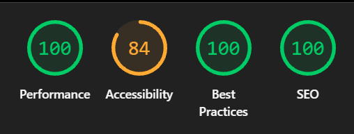
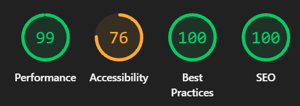
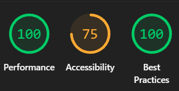
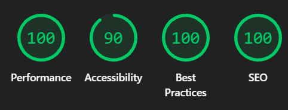
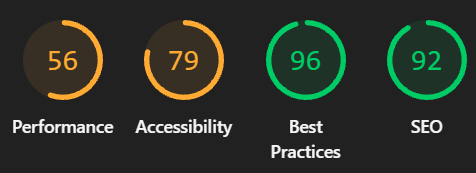

# Проверка метатегов, sitemap, Lighthouse, Core Web Vitals

## 1. Подготовка к аудиту

Проект запущен в продакшен-режиме с помощью Docker Compose. Все контейнеры работают корректно.

Проверка проводилась в окне инкогнито для исключения влияния расширений и кэша.

### Список страниц для аудита

В таблице 1 представлен список всех страниц проекта «Тильт-платеж», разделенных по типу доступа и способу проверки.

**Таблица 1 — Список страниц проекта для аудита**
| Страница (Route) | Компонент | Тип страницы | Как проверяем | Категории Lighthouse |
| ---- | ---- | ---- | ---- | ---- |
| `/` | HomePage | публичная, есть в sitemap.xml | окно инкогнито, 3 запуска | все 4 |
| `/catalog` | CatalogPage | публичная, есть в sitemap.xml | окно инкогнито, 3 запуска | все 4 |
| `/services/:id` | ServicePage | публичная (динамическая) | окно инкогнито, 3 запуска | все 4 |
| `/login` | LoginPage | закрыта в robots.txt | окно инкогнито, 3 запуска | без SEO |
| `/register` | RegisterPage | закрыта в robots.txt | окно инкогнито, 3 запуска | без SEO |
| `/profile` | ProfilePage | закрыта в robots.txt, нужен вход | после входа в инкогнито, 1 запуск | без SEO |
| `/orders` | OrdersPage | закрыта в robots.txt, нужен вход | после входа в инкогнито, 1 запуск | без SEO |
| `/favorites` | FavoritesPage | закрыта в robots.txt, нужен вход | после входа в инкогнито, 1 запуск | без SEO |
| `/my-services` | MyServicePage | закрыта в robots.txt, нужен вход | после входа в инкогнито, 1 запуск | без SEO |
| `/admin` | AdminPage | закрыта в robots.txt, нужен вход | после входа в инкогнито, 1 запуск | без SEO |
| `/checkout` | CheckoutPage | закрыта в robots.txt, нужен вход | после входа в инкогнито, 1 запуск | без SEO |
| `/payment` | PaymentPage | закрыта в robots.txt, нужен вход | после входа в инкогнито, 1 запуск | без SEO |
| `/wallet` | WalletPage | закрыта (не в sitemap), нужен вход | после входа в инкогнито, 1 запуск | без SEO |
| `/support` | SupportPage | закрыта (не в sitemap), нужен вход | после входа в инкогнито, 1 запуск | без SEO |
| `/settings` | SettingPage | закрыта (не в sitemap), нужен вход | после входа в инкогнито, 1 запуск | без SEO |
| `/services/new` (или edit) | ServiceFormPage | закрыта (не в sitemap), нужен вход | после входа в инкогнито, 1 запуск | без SEO |

## 2. Аудит Lighthouse

Аудит проводился в окне инкогнито в режиме Desktop по четырем категориям. 
Для публичных страниц было выполнено по 3 запуска, в таблицу заносится медианное значение.

### 2.1. Главная страница (/)

**Результаты трех запусков:**
* Запуск 1: Performance 100, Accessibility 78, Best Practices 100, SEO 100.
* Запуск 2: Performance 100, Accessibility 78, Best Practices 100, SEO 100.
* Запуск 3: Performance 100, Accessibility 78, Best Practices 100, SEO 100.

**Медианные значения:** 
* Performance: **100**
* Accessibility: **78** 
* Best Practices: **100**
* SEO: **100**

**Метрики производительности (первый запуск):**
* FCP (First Contentful Paint): 0.7 s
* LCP (Largest Contentful Paint): 0.7 s
* TBT (Total Blocking Time): 0 ms
* CLS (Cumulative Layout Shift): 0
* Speed Index: 0.7 s

### 2.2. Страница Каталога (/catalog)

**Результаты трех запусков:**
* Запуск 1: Performance 100, Accessibility 84, Best Practices 100, SEO 100.
* Запуск 2: Performance 100, Accessibility 84, Best Practices 100, SEO 100.
* Запуск 3: Performance 100, Accessibility 84, Best Practices 100, SEO 100.

**Медианные значения:** 
* Performance: **100**
* Accessibility: **84** 
* Best Practices: **100**
* SEO: **100**

**Метрики производительности (первый запуск):**
* FCP (First Contentful Paint): 0.7 s
* LCP (Largest Contentful Paint): 0.7 s
* TBT (Total Blocking Time): 0 ms
* CLS (Cumulative Layout Shift): 0
* Speed Index: 0.7 s

### 2.3. Страница Карточки услуги (/services/:id)

**Результаты трех запусков:**
* Запуск 1: Performance 99, Accessibility 76, Best Practices 100, SEO 100.
* Запуск 2: Performance 99, Accessibility 76, Best Practices 100, SEO 100.
* Запуск 3: Performance 99, Accessibility 76, Best Practices 100, SEO 100.

**Медианные значения:** 
* Performance: **99**
* Accessibility: **76** 
* Best Practices: **100**
* SEO: **100**

**Метрики производительности (первый запуск):**
* FCP (First Contentful Paint): 0.7 s
* LCP (Largest Contentful Paint): 0.9 s
* TBT (Total Blocking Time): 0 ms
* CLS (Cumulative Layout Shift): 0
* Speed Index: 0.7 s

### 2.4. Страница Входа (/login)

*Так как страница закрыта от индексации в robots.txt, категория SEO не проверялась.*

**Результаты трех запусков:**
* Запуск 1: Performance 100, Accessibility 73, Best Practices 100.
* Запуск 2: Performance 100, Accessibility 73, Best Practices 100.
* Запуск 3: Performance 100, Accessibility 73, Best Practices 100.

**Медианные значения:** 
* Performance: **100**
* Accessibility: **73** 
* Best Practices: **100**

**Метрики производительности (первый запуск):**
* FCP: 0.7 s | LCP: 0.7 s | TBT: 0 ms | CLS: 0 | SI: 0.7 s

### 2.5. Страница Регистрации (/register)

*Так как страница закрыта от индексации в robots.txt, категория SEO не проверялась.*

**Результаты трех запусков:**
* Запуск 1: Performance 100, Accessibility 75, Best Practices 100.
* Запуск 2: Performance 100, Accessibility 75, Best Practices 100.
* Запуск 3: Performance 100, Accessibility 75, Best Practices 100.

**Медианные значения:** 
* Performance: **100**
* Accessibility: **75** 
* Best Practices: **100**

**Метрики производительности (первый запуск):**
* FCP: 0.7 s | LCP: 0.7 s | TBT: 0 ms | CLS: 0 | SI: 0.7 s

### 2.6. Страница Личного кабинета (/profile)

*Страница требует авторизации. Проверка проводилась после входа в окне инкогнито, 1 запуск. Категория SEO не проверялась, так как страница закрыта в robots.txt.*

**Результаты:**
* Performance: **91**
* Accessibility: **76** 
* Best Practices: **100**

**Метрики производительности:**
* FCP: 0.7 s | LCP: 0.9 s | TBT: 0 ms | **CLS: 0.178** | SI: 0.7 s

### 2.7. Страница Админ-панели (/admin)

*Страница требует авторизации. Проверка проводилась после входа в окне инкогнито, 1 запуск. Категория SEO не проверялась.*

**Результаты:**
* Performance: **98**
* Accessibility: **84** 
* Best Practices: **100**

**Метрики производительности:**
* FCP: 0.8 s | LCP: 1.0 s | TBT: 0 ms | CLS: 0.01 | SI: 0.8 s

## 3. Анализ найденных проблем и их исправление

В ходе аудита были выявлены основные проблемы, влияющие на оценку категории Accessibility. Оценка Performance на всех страницах находилась в зеленой зоне (91-100), за исключением страницы профиля, где наблюдался сдвиг макета.

### Результат повторного замера (Главная страница):
* До исправлений: Accessibility = **78**
* После исправлений: Accessibility = **90** 

Для повышения оценки категории Accessibility были выполнены следующие шаги:
1. **Добавлены атрибуты доступности:** Для кнопки мобильного меню и кнопки закрытия меню добавлен атрибут `aria-label` с описанием действия. Для иконки уведомлений также добавлен `aria-label`. Это позволило скринридерам корректно считывать назначение элементов.
2. **Улучшена контрастность текста:** Темно-серый цвет `#805861`, который использовался для второстепенного текста в карточках услуг, футере и заголовках, был заменен на более светлый `#b88b94`.
3. **Исправлена кнопка с иконкой:** Для кнопки закрытия мобильного меню, имеющей класс `text-[#c59ca4]`, добавлен `aria-label="Закрыть меню"`.

**Итоговые метрики производительности после оптимизации:**
* FCP: 0.7 s | LCP: 0.7 s | TBT: 0 ms | CLS: 0.011 | SI: 0.7 s

## 4. Сравнение с сайтом-аналогом

Для сравнения был выбран популярный сайт-аналог **GGSel**, предоставляющий схожие услуги по продаже игрового контента. Замер проводился в окне инкогнито, в режиме Desktop, по всем четырем категориям (1 запуск).

**Таблица 2 — Сравнение показателей проекта «Тильт-платеж» и сайта-аналога GGSel**

| Категория | Проект «Тильт-платеж» | Сайт-аналог GGSel | Комментарий |
| :--- | :--- | :--- | :--- |
| **Performance** | **100** | **56** | Проект загружается значительно быстрее. У аналога высокий TBT и LCP из-за тяжелых скриптов и рекламы. |
| **Accessibility** | **90** | **79** | Проект имеет лучшую доступность благодаря проведенной оптимизации контраста и добавлению aria-атрибутов. |
| **Best Practices** | **100** | **96** | Оба проекта соблюдают современные стандарты безопасности. |
| **SEO** | **100** | **92** | Проект имеет идеальные показатели SEO благодаря корректно настроенным метатегам, robots.txt и sitemap.xml. |

**Метрики производительности GGSel (для сравнения):**
* FCP: 1.3 s | **LCP: 3.2 s** | **TBT: 400 ms** | CLS: 0.002 | SI: 2.5 s

**Вывод:** 
Разработанное веб-приложение «Тильт-платеж» демонстрирует значительно более высокие показатели производительности и SEO по сравнению с крупным конкурентом. Это достигается за счет отсутствия тяжелой рекламы, оптимизированной верстки и правильной настройки серверной части. Проведенный аудит и исправление проблем с доступностью позволили довести все ключевые метрики до «зеленой» зоны.

## 5. Ручная проверка метатегов и навигации

В ходе аудита были проведены следующие ручные проверки:
*   **Метатеги в исходном HTML-коде:** Проверено наличие тега `<title>` (уникальный для каждой страницы) и `<meta name="description">` на главной странице и в каталоге. На странице входа и регистрации установлен метатег `<meta name="robots" content="noindex, nofollow">`.
*   **robots.txt:** Файл доступен по адресу `/robots.txt`. Проверено, что он корректно закрывает служебные страницы (`/admin`, `/profile`, `/login` и др.) и указывает на актуальный `sitemap.xml`.
*   **sitemap.xml:** Файл доступен, проверено, что в нем указаны только публичные страницы с актуальной датой изменения.
*   **Навигация с клавиатуры:** Проверено, что все интерактивные элементы доступны для фокуса с помощью клавиши `Tab`, имеют видимую обводку фокуса, а логические переходы между полями формы осуществляются клавишей `Enter`.

## 8. Список неисправленных проблем и причины

В ходе аудита были выявлены проблемы, которые было решено не исправлять в рамках данной работы по следующим причинам:

1.  **Неадаптивная верстка (Mobile):** В проекте отсутствует адаптивная верстка для мобильных устройств. Поисковые системы в первую очередь индексируют мобильную версию. *Причина:* Это требует значительной переработки Tailwind и выходит за рамки текущего задания, однако это является главным приоритетом для дальнейшего развития проекта.
2.  **Сложность контраста для брендинга:** Красный цвет логотипа «Тильт-Платёж» на темном фоне не идеален с точки зрения строгих стандартов WCAG. *Причина:* Осознанный выбор бренда, который сохранила для узнаваемости.
3.  **CLS на странице профиля (0.178):** Сдвиг макета при загрузке динамических данных. *Причина:* Требует внедрения скелетон-загрузки для всех динамических блоков, что пока не реализовано.