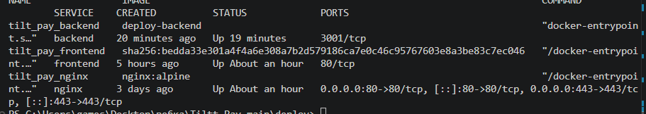
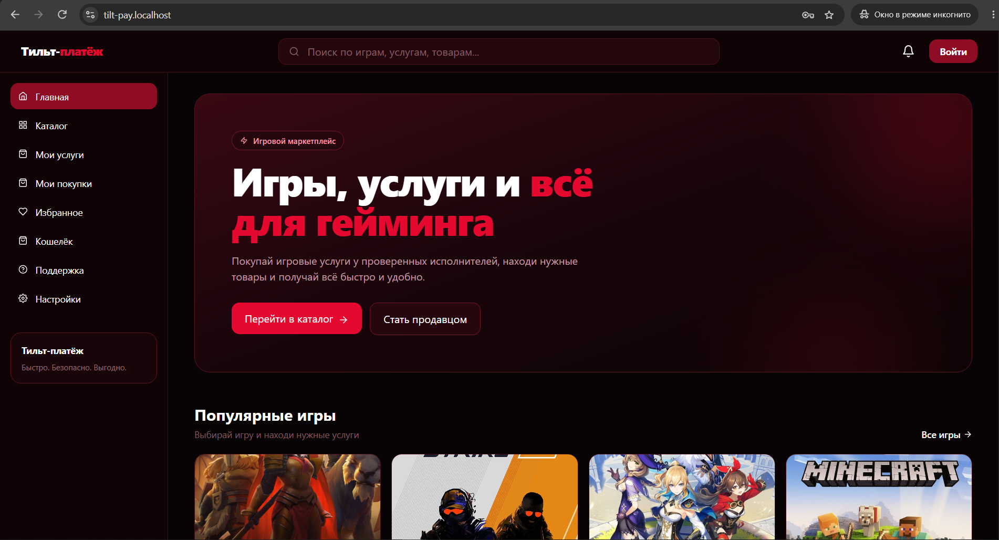
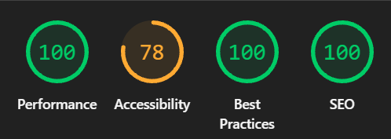
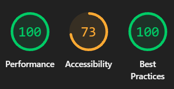
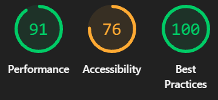
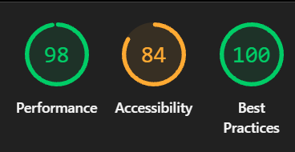

# Проверка метатегов, sitemap, Lighthouse, Core Web Vitals

## 1. Подготовка к аудиту

Проект запущен в продакшен-режиме с помощью Docker Compose. Все контейнеры работают корректно.

Проверка проводилась в окне инкогнито для исключения влияния расширений и кэша.

### Список страниц для аудита

В таблице 1 представлен список всех страниц проекта «Тильт-платеж», разделенных по типу доступа и способу проверки.

**Таблица 1 — Список страниц проекта для аудита**
| Страница (Route) | Компонент | Тип страницы | Как проверяем | Категории Lighthouse |
| ---- | ---- | ---- | ---- | ---- |
| `/` | HomePage | публичная, есть в sitemap.xml | окно инкогнито, 3 запуска | все 4 |
| `/catalog` | CatalogPage | публичная, есть в sitemap.xml | окно инкогнито, 3 запуска | все 4 |
| `/services/:id` | ServicePage | публичная (динамическая) | окно инкогнито, 3 запуска | все 4 |
| `/login` | LoginPage | закрыта в robots.txt | окно инкогнито, 3 запуска | без SEO |
| `/register` | RegisterPage | закрыта в robots.txt | окно инкогнито, 3 запуска | без SEO |
| `/profile` | ProfilePage | закрыта в robots.txt, нужен вход | после входа в инкогнито, 1 запуск | без SEO |
| `/orders` | OrdersPage | закрыта в robots.txt, нужен вход | после входа в инкогнито, 1 запуск | без SEO |
| `/favorites` | FavoritesPage | закрыта в robots.txt, нужен вход | после входа в инкогнито, 1 запуск | без SEO |
| `/my-services` | MyServicePage | закрыта в robots.txt, нужен вход | после входа в инкогнито, 1 запуск | без SEO |
| `/admin` | AdminPage | закрыта в robots.txt, нужен вход | после входа в инкогнито, 1 запуск | без SEO |
| `/checkout` | CheckoutPage | закрыта в robots.txt, нужен вход | после входа в инкогнито, 1 запуск | без SEO |
| `/payment` | PaymentPage | закрыта в robots.txt, нужен вход | после входа в инкогнито, 1 запуск | без SEO |
| `/wallet` | WalletPage | закрыта (не в sitemap), нужен вход | после входа в инкогнито, 1 запуск | без SEO |
| `/support` | SupportPage | закрыта (не в sitemap), нужен вход | после входа в инкогнито, 1 запуск | без SEO |
| `/settings` | SettingPage | закрыта (не в sitemap), нужен вход | после входа в инкогнито, 1 запуск | без SEO |
| `/services/new` (или edit) | ServiceFormPage | закрыта (не в sitemap), нужен вход | после входа в инкогнито, 1 запуск | без SEO |

## 2. Аудит Lighthouse

Аудит проводился в окне инкогнито в режиме Desktop по четырем категориям. 
Для публичных страниц было выполнено по 3 запуска, в таблицу заносится медианное значение.

### 2.1. Главная страница (/)

**Результаты трех запусков:**
* Запуск 1: Performance 100, Accessibility 78, Best Practices 100, SEO 100.
* Запуск 2: Performance 100, Accessibility 78, Best Practices 100, SEO 100.
* Запуск 3: Performance 100, Accessibility 78, Best Practices 100, SEO 100.

**Медианные значения:** 
* Performance: **100**
* Accessibility: **78** 
* Best Practices: **100**
* SEO: **100**

**Метрики производительности (первый запуск):**
* FCP (First Contentful Paint): 0.7 s
* LCP (Largest Contentful Paint): 0.7 s
* TBT (Total Blocking Time): 0 ms
* CLS (Cumulative Layout Shift): 0
* Speed Index: 0.7 s

### 2.2. Страница Каталога (/catalog)

**Результаты трех запусков:**
* Запуск 1: Performance 100, Accessibility 84, Best Practices 100, SEO 100.
* Запуск 2: Performance 100, Accessibility 84, Best Practices 100, SEO 100.
* Запуск 3: Performance 100, Accessibility 84, Best Practices 100, SEO 100.

**Медианные значения:** 
* Performance: **100**
* Accessibility: **84** 
* Best Practices: **100**
* SEO: **100**

**Метрики производительности (первый запуск):**
* FCP (First Contentful Paint): 0.7 s
* LCP (Largest Contentful Paint): 0.7 s
* TBT (Total Blocking Time): 0 ms
* CLS (Cumulative Layout Shift): 0
* Speed Index: 0.7 s

### 2.3. Страница Карточки услуги (/services/:id)

**Результаты трех запусков:**
* Запуск 1: Performance 99, Accessibility 76, Best Practices 100, SEO 100.
* Запуск 2: Performance 99, Accessibility 76, Best Practices 100, SEO 100.
* Запуск 3: Performance 99, Accessibility 76, Best Practices 100, SEO 100.

**Медианные значения:** 
* Performance: **99**
* Accessibility: **76** 
* Best Practices: **100**
* SEO: **100**

**Метрики производительности (первый запуск):**
* FCP (First Contentful Paint): 0.7 s
* LCP (Largest Contentful Paint): 0.9 s
* TBT (Total Blocking Time): 0 ms
* CLS (Cumulative Layout Shift): 0
* Speed Index: 0.7 s

### 2.4. Страница Входа (/login)

*Так как страница закрыта от индексации в robots.txt, категория SEO не проверялась.*

**Результаты трех запусков:**
* Запуск 1: Performance 100, Accessibility 73, Best Practices 100.
* Запуск 2: Performance 100, Accessibility 73, Best Practices 100.
* Запуск 3: Performance 100, Accessibility 73, Best Practices 100.

**Медианные значения:** 
* Performance: **100**
* Accessibility: **73** 
* Best Practices: **100**

**Метрики производительности (первый запуск):**
* FCP: 0.7 s | LCP: 0.7 s | TBT: 0 ms | CLS: 0 | SI: 0.7 s

### 2.5. Страница Регистрации (/register)

*Так как страница закрыта от индексации в robots.txt, категория SEO не проверялась.*

**Результаты трех запусков:**
* Запуск 1: Performance 100, Accessibility 75, Best Practices 100.
* Запуск 2: Performance 100, Accessibility 75, Best Practices 100.
* Запуск 3: Performance 100, Accessibility 75, Best Practices 100.

**Медианные значения:** 
* Performance: **100**
* Accessibility: **75** 
* Best Practices: **100**

**Метрики производительности (первый запуск):**
* FCP: 0.7 s | LCP: 0.7 s | TBT: 0 ms | CLS: 0 | SI: 0.7 s

### 2.6. Страница Личного кабинета (/profile)

*Страница требует авторизации. Проверка проводилась после входа в окне инкогнито, 1 запуск. Категория SEO не проверялась, так как страница закрыта в robots.txt.*

**Результаты:**
* Performance: **91**
* Accessibility: **76** 
* Best Practices: **100**

**Метрики производительности:**
* FCP: 0.7 s | LCP: 0.9 s | TBT: 0 ms | **CLS: 0.178** | SI: 0.7 s

### 2.7. Страница Админ-панели (/admin)

*Страница требует авторизации. Проверка проводилась после входа в окне инкогнито, 1 запуск. Категория SEO не проверялась.*

**Результаты:**
* Performance: **98**
* Accessibility: **84** 
* Best Practices: **100**

**Метрики производительности:**
* FCP: 0.8 s | LCP: 1.0 s | TBT: 0 ms | CLS: 0.01 | SI: 0.8 s

